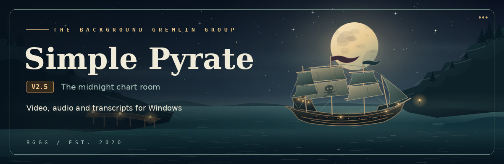
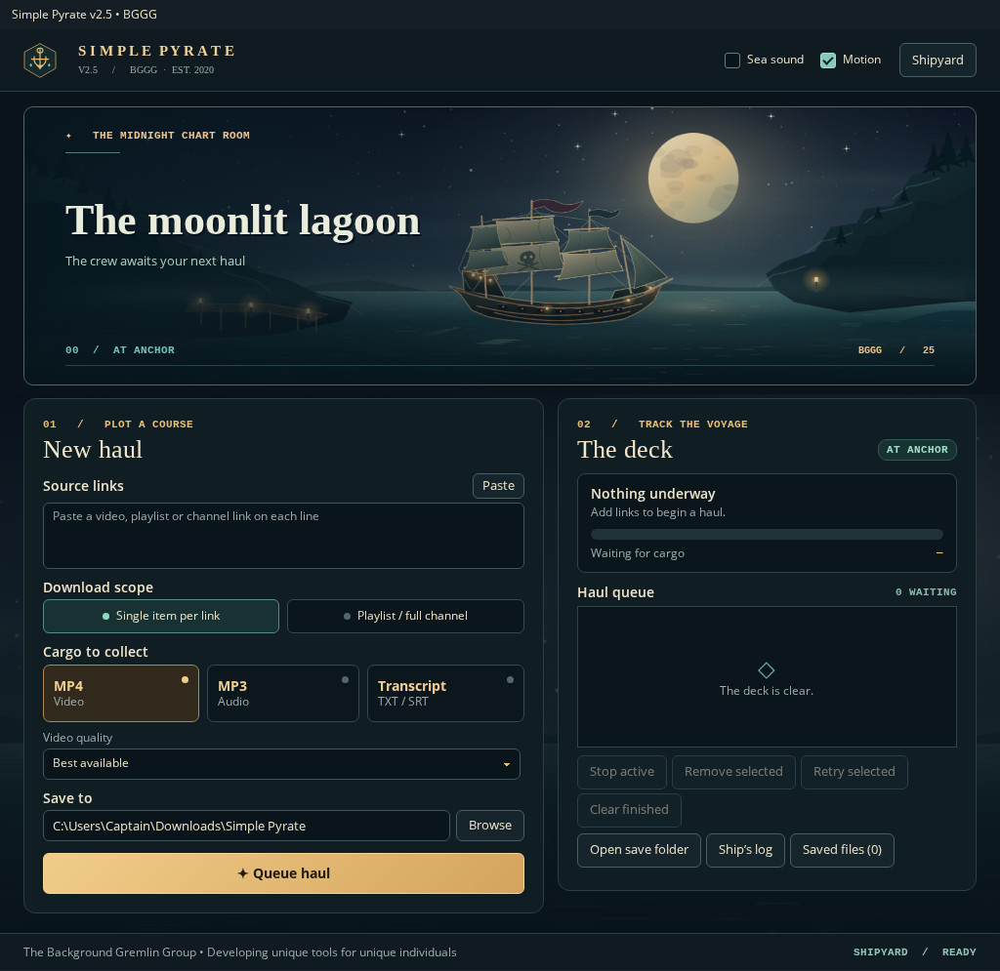
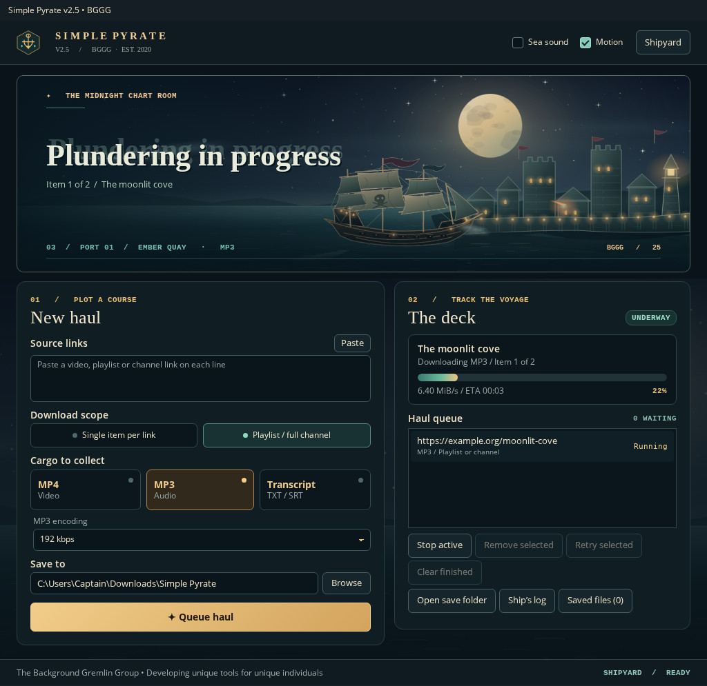

# Simple Pyrate v2.5

**A dark Windows desktop downloader for video, audio, and transcripts.** Paste a link, choose what to save, and watch your ship leave the lagoon. Each item in a channel or playlist haul gets its own port encounter.

[Download the Windows ZIP](https://github.com/bggg-gizmo/simple-pyrate/raw/refs/heads/main/Simple-Pyrate-v2.5-Windows.zip) · [User guide](docs/USER-GUIDE.md) · [Troubleshooting](docs/TROUBLESHOOTING.md) · [Development and verification](docs/DEVELOPMENT.md)

## Quick start

1. Download the ZIP above and **extract it fully**. Alternatively, use **Code → Download ZIP** to get the repo source and extract that.
2. On Windows, double-click **`Start-Simple-Pyrate.cmd`** from the extracted app folder. Keep it beside the other scripts and the `assets` folder.
3. If **Shipyard** finds missing tools, choose **Install missing tools** and approve the Windows prompt. It installs yt-dlp, FFmpeg, FFprobe, and Deno as needed on the **machine-wide PATH**. Normal downloads do not require elevation.
4. Paste one link per line, choose **Single item per link** or **Playlist / full channel**, select formats, and click **Queue haul**. **Ctrl+Enter** works too.

**Requirements:** 64-bit Windows 10 or 11, Windows PowerShell 5.1, and .NET Framework 4.8. The app is a source bundle with a CMD launcher, not a compiled EXE. Python, Node.js, and the .NET SDK are not needed to use it. Internet access is needed for tool setup and downloads.

## Choose your cargo

| Choice | What it saves | Subfolder |
| --- | --- | --- |
| **MP4** | Video with audio when present. Choose best available or cap the video quality. | `Video` |
| **MP3** | Audio only. Choose 128, 192, or 320 kbps, or best variable bitrate. | `Audio` |
| **Transcript** | Plain TXT, timed SRT, or both from available captions. No video or audio is downloaded if Transcript is the only choice. | `Transcripts` |

Select any combination. The default save folder is `%USERPROFILE%\Downloads\Simple Pyrate` on a fresh setup. Change it with **Browse**.

Simple Pyrate uses [yt-dlp’s extractors](https://github.com/yt-dlp/yt-dlp/blob/master/supportedsites.md) for YouTube, Rumble, TikTok, Instagram, X, and other supported sources. Coverage is per link. A site may support individual posts without exposing an entire profile, and a video may not have a caption track in the language you select.

## The voyage

| At anchor | Plundering in progress |
| :---: | :---: |
|  |  |

*These are UI previews recreated from the shipped XAML, original artwork, and scene renderer, with sample download data. They are not native Windows screenshots.*

The ship leaves the moonlit lagoon, shows source-reported waits at sea, fires a salvo at each port, and returns after the last encounter. The visuals never delay downloads. **Motion** pauses decorative animation and **Sea sound** turns on the bundled ambience.

## Project docs

- [User guide](docs/USER-GUIDE.md) covers full-channel hauls, captions, the queue, Shipyard, and removal.
- [Troubleshooting](docs/TROUBLESHOOTING.md) covers startup, missing tools, blocked sources, and partial downloads.
- [Development and verification](docs/DEVELOPMENT.md) covers the source layout, local tests, and Windows checks.
- [Changelog](CHANGELOG.md) records what shipped in v2.5.

**Developed by The Background Gremlin Group**  
Developing unique tools for unique individuals · **BGGG / Est. 2020**
