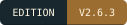
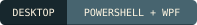
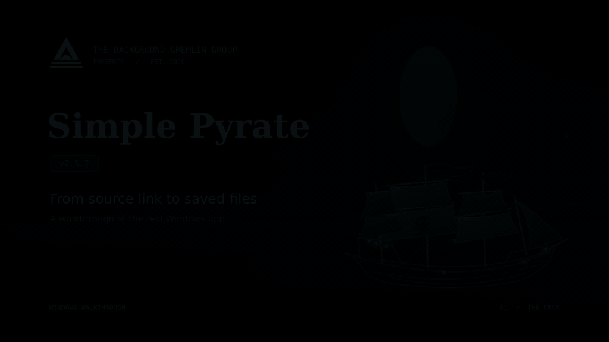

# Simple Pyrate v2.6.3


  

**A Windows and Android downloader for video, audio, and transcripts.**

[Changelog](CHANGELOG.md) · [User guide](docs/USER-GUIDE.md) · [Troubleshooting](docs/TROUBLESHOOTING.md) · [Windows test checklist](docs/WINDOWS-TEST.md) · [v2.5.2 audit](docs/V2.5.2-AUDIT.md)

Developed by **The Background Gremlin Group**  
Developing unique tools for unique individuals · **BGGG / Est. 2020**

## Walkthrough

See Simple Pyrate queue an MP4 and transcript, sail from port to port, and return to harbor when the haul is complete.



[Open the walkthrough GIF](assets/Simple-Pyrate-v2.5.7-Walkthrough.gif)

## Get the source

The `main` branch contains the v2.6.3 source. Clone the repository or use **Code → Download ZIP**. The Windows and Android build files are not published on GitHub. If you already have a v2.6.3 package from the maintainer, check its SHA-256 against [SHA256SUMS.txt](SHA256SUMS.txt).

| Platform | Getting started |
| --- | --- |
| Windows 10 and 11 (x64 or ARM64) | From the checkout, run `Start-Simple-Pyrate.cmd`. Shipyard can check and install supported dependencies. |
| Android 10 or newer (ARM64 or x86-64) | See the [Android build instructions](android/README.md). If you already have the signed APK, see the [installation guide](android/docs/ANDROID-INSTALL.md). |

v2.6.3 is a release candidate. The Windows engine was tested with local fixtures under PowerShell 7 on Linux. The signed APK passed package checks, but this exact build has not been tested on an Android device. Its signing certificate differs from v2.6.2.

## This Windows build

**v2.6.3 keeps the Windows artwork, voyage, sound mix, and settings from the accepted v2.5.7 build.** Port-to-port sailing holds the ship’s heading and scrolls the coast from right to left. Effects, ship bells and sea ambience share one Windows output stream. Original artwork, recordings, and saved settings are retained.

Follow the [Windows test checklist](docs/WINDOWS-TEST.md) for native Windows validation.

**Sound defaults.** Port effects and ship bells are on for new profiles. If you upgraded from a build that saved them off, open **Settings → Port sound effects** and enable them once. Sea ambience has its own switch, so hearing the sea doesn’t mean port effects are on.

The full Windows package includes bundled x64 and ARM64 dependencies. The Git checkout has the launcher, first-run setup, ship bells, and original assets, and uses Shipyard or existing tools on the system PATH if the bundled files are not present. Keep this version in its own folder.

[Original v2.5.2 Windows package](https://github.com/bggg-gizmo/simple-pyrate/blob/main/old_builds/v2.5.2/Simple-Pyrate-v2.5.2-Windows.zip) · [Original package SHA-256](SHA256SUMS.txt)

The original packaged ZIP is unchanged and does not contain the setup and bell update.

## Launch on Windows

1. Open the checkout or extracted source folder that contains `Start-Simple-Pyrate.cmd`. Keep its scripts and assets together. Do not run the launcher from `old_builds` unless you want an older version.
2. Double-click **Start-Simple-Pyrate.cmd**. It opens the desktop window using Windows PowerShell 5.1 in STA mode. Windows needs .NET Framework 4.8 (included with Windows 11 and Windows 10 22H2). No Python, virtual environment, Node.js, browser or .NET SDK is needed to launch it.
3. The wizard opens with **Welcome to Simple Pyrate** and **Let’s set up your ship**. It guides you through the save folder, portable or per-user app install, optional Desktop shortcut, and dependency check. If anything is missing, click **Install missing tools** and approve the Windows prompt. Click **Finish** when the inspection is ready. Existing save preferences carry over.
4. If you chose a per-user install, launch **Simple Pyrate v2.6.3** from the Start Menu next time. For portable mode, keep the extracted folder in place.
5. Paste one complete link per line. Choose **Single item per link** or **Playlist / full channel**, pick the formats, and click **Queue haul** or press **Ctrl+Enter**.

The app ships as full source with a CMD launcher, not as a compiled EXE. Run `Start-Simple-Pyrate.cmd -Setup` or choose **Settings → First-run setup** to reopen the wizard. It targets 64-bit Windows 10 and 11 (x64 and ARM64). The launcher uses a process-only PowerShell execution-policy override. It does not change Windows’ machine or user execution policy or bypass a system administrator’s Group Policy.

## Choose what to save

| Choice | What you get | Folder |
| --- | --- | --- |
| MP4 | Video with audio when present. Video quality can be capped from 480p to 2160p. | `Video` |
| MP3 | Audio only. Choose 128, 192, 320 kbps, or the best variable bitrate. | `Audio` |
| Transcript → TXT | Plain text from a caption track, with timings and styling removed. No media or SRT is retained in this mode. | `Transcripts` |
| Transcript → SRT | Timed subtitle files. No media is downloaded if Transcript is the only mode selected. | `Transcripts` |
| Transcript → Both | TXT and SRT from the same matching tracks. | `Transcripts` |

Check any combination. Each URL is one queue entry, with a separate pass for each selected output. Paste a YouTube channel’s main URL in **Playlist / full channel** mode for the uploads yt-dlp can enumerate, including Shorts and streamed uploads where available. A `/videos`, `/shorts` or `/streams` URL restricts a YouTube haul to that tab. A playlist link without collection mode processes only its first entry. Some extractors accept posts or individual videos but cannot enumerate a whole profile. For an unsupported profile, paste the direct links you want in the batch.

The fresh-install default location is `%USERPROFILE%\Downloads\Simple Pyrate`. **Browse** lets you enter a new path, navigate folders, or choose another drive. **Saved files** lists available files from this session, including valid finished files found in the destination on retries. Double-click a file to open it. Your selections and destination are remembered. The queue, saved-file list, and ship’s log are session-only.

Use **Stop active** to stop the current haul, **Remove selected** for a queued entry, and **Retry selected** for a failed, stopped, or partial entry. Finished files are retained and existing outputs are not overwritten. An interrupted media download can leave a part file for yt-dlp to resume when the source supports it. **Clear finished** clears rows, not files. **Motion** controls the cinematic scenes, animated backdrop, and progress sweep. **Sea sound** plays the bundled local ambience and is off by default.

## The voyage

- **Ready to download.** The ship is at harbor until a haul starts.
- **Setting sail.** Ghostly titles drift through fog while the ship leaves the cove. The next cut is open water. If yt-dlp reports a wait, the open-water shot shows the remaining time. Simple Pyrate does not impose a blanket three-second delay.
- **Plundering in progress.** Each resolved video, audio, or transcript item is its own numbered port encounter. Four fictional port silhouettes rotate as the coastline changes. While an encounter is active, the ship fires animated salvos, with muzzle light, flying sparks, and drifting smoke. An item that has no matching subtitles still gets an encounter, and the queue reports that no file was saved.
- **On to the next port.** Successive items or queued links stay on one voyage. Each battle is separated by an open-water shot. Very fast items can finish before their scenes play, so the cutscenes can briefly catch up after the download queue is done. They never hold up downloading, file saving, or the queue.
- **Making for harbor.** After the last encounter, the ship returns to harbor. Cancelling the last job skips the pending visual encounters and turns the ship for harbor immediately. Turning off Motion removes the animated transitions and decorative effects.

### Port raid milestones

| Item transfer | What happens on screen |
| --- | --- |
| 30% | Fires spread along the port. |
| 50% | Dinghies launch, and the crew goes ashore. |
| 75% | The crew carries crates to the dinghies. |
| 80% | Cargo is hoisted aboard. |
| 95% | The crew climbs back aboard. |
| 98% | The dinghies are stowed, and most of the port is in ruins. |

The raid uses the highest observed transfer percentage for each item. Split video and audio streams share one progress bar. When a very quick item or transcript save skips intermediate updates, the cutscene replays the milestones in order without blocking transfers. A successful save finishes the sequence, while an item that saves nothing does not get a completion boost. With **Motion** off, the app shows still frames and skips the replay.

### Captain’s settings

Choose **Moonlit Watch**, **Corsair Run**, or **All chart-room tracks** to loop four original pirate-themed songs. The ZIP includes the editable MIDI scores and the matching offline MP3 renders, so playback does not depend on a MIDI synthesizer. **Next track**, music volume, and port effects volume are independent. Music is off and port sound effects are on for new profiles, and the existing **Sea sound** switch still controls ocean ambience separately.

Enable **Settings → Port sound effects** to hear the ship bell. It strikes three times when a haul starts, twice for each port in a batch, and five times when the queue finishes. A cancelled queue does not play the finish bell. Bell cues play in order without delaying transfers or depending on the Motion setting. Music and sea sound are still independent.

For authorized account access, open **Captain’s settings → Source access**, select the browser where you are signed in, and click **Use browser sign-in**. This applies to new hauls during the current app session. Browser availability, cookie stores, and supported sites vary. If the browser does not allow yt-dlp access, choose a supported browser where you are signed in, such as Firefox, or import your own cookies.txt. Browser sign-in does not generate a YouTube PO token. Manual token input remains available.

Use **Support the crew · XMR donation** to jump straight to the donation controls. The settings also offer **Open Monero donation link** and **Copy XMR address**. Opening the link delegates to your registered Monero wallet. Simple Pyrate never starts or submits a payment.

### What happens after an MP4 download

A source already downloaded as MP4 is kept as-is. For other containers, Simple Pyrate copies compatible streams into MP4 rather than re-encoding them. If only the audio is incompatible, it converts only the audio. If video must be encoded, FFmpeg uses H.264 and a faster preset. Resolution caps still apply to source selection.

**Processing** distinguishes stream merge, remux and encoding from source resolution. When FFprobe can determine duration, the MP4 finalizer reports FFmpeg’s actual progress, encoding speed, and ETA when available. Without duration it shows an indeterminate bar and elapsed time. The final file is only reported as saved after it is moved into place. Cancellation or errors preserve the original downloaded media and clean up incomplete conversion output.

## Captions and sites

Simple Pyrate uses yt-dlp’s extractors for YouTube, Rumble, TikTok, Instagram, X and other supported sites. Support depends on the exact URL and what the site serves. Browser cookies are used only if you opt into a supported browser session. The app does not bypass access restrictions or DRM. Some sources require an authorized account, and some profiles do not expose an upload list.

For authenticated sources, open **Settings → Source access**. You can import a Netscape-format cookie export from your own authorized session. For YouTube, you can also enter a yt-dlp PO token in the documented client.context+token format. The PO token is not a substitute for sign-in or source-side age verification. Credentials apply to new hauls in the current session only. They are not saved in app preferences or passed as raw command-line values.

The language field accepts codes such as `en`, `de`, `pt-BR`, or comma-separated combinations. A base language can match regional tracks. Use `all` alone for every exposed caption language except live chat. Manually supplied subtitles take precedence over automatic captions for the same language. Automatic captions are optional and only work where the source exposes them. Simple Pyrate does not generate new captions from speech. When a source publishes no matching convertible track, the app reports that in the queue and log.

## What Shipyard changes

- Checks the **Windows system PATH** first, then uses the appropriate bundled x64 or ARM64 copy if a tool is missing. It does not search user PATH or virtual environments. FFmpeg and FFprobe must be in the same PATH directory.
- Installs missing tools under `%ProgramFiles%\BGGG\Blackwake\bin`, verifies the downloaded release asset against its published SHA-256 and byte count, then adds the directory to the machine PATH in the Windows registry. App sessions read the updated machine PATH directly. An already-open terminal may need to be reopened.
- Reuses existing tools on the machine PATH. **Refresh managed tools** installs or updates verified copies in its managed machine-wide directory and leaves unrelated copies untouched. The original files inside this extracted ZIP remain intact. Simple Pyrate runs its job worker without requesting elevation. Run the app normally and let Windows elevate only Shipyard.
- Upstream builds come from [yt-dlp](https://github.com/yt-dlp/yt-dlp/releases), [BtbN FFmpeg Builds](https://github.com/FFmpeg-Builds/FFmpeg-Builds/releases) and [Deno](https://github.com/denoland/deno/releases). Existing Deno installations should be at least 2.3. Existing yt-dlp executables should be current.
- For a portable copy, delete its extracted folder. For a per-user install of the current update, delete `%LOCALAPPDATA%\BGGG\Simple Pyrate\App-2.6.3` and its shortcuts. The upgrade leaves the previous `App-2.5.2`, `App-2.5.2-setup2`, `App-2.5.3`, `App-2.5.4`, `App-2.5.5`, and `App-2.5.6` folders alone. The existing settings path, `%LOCALAPPDATA%\BGGG\Blackwake`, is preserved so an update picks up your preferred save folder and other options. The managed Program Files directory is also reused. To remove its managed tools as well, remove only the existing Blackwake bin entry from **System Properties → Advanced → Environment Variables → System variables → Path** and delete `%ProgramFiles%\BGGG\Blackwake` as an administrator. This does not touch your downloads or tools installed by other apps.

## Verification

v2.6.3 retains the v2.5.1 System.Xaml startup fix. `-SmokeTest` is synchronous and returns a failure code. `-Diagnose` runs the app in the console. Startup errors point to `%LOCALAPPDATA%\BGGG\Blackwake\startup-error.log` when available.

On Windows, check the native interface and progress control from Command Prompt:

```cmd
Start-Simple-Pyrate.cmd -SmokeTest
```

Run the engine and voyage timeline checks:

```cmd
powershell.exe -NoProfile -ExecutionPolicy Bypass -File ".\tests\Engine.Tests.ps1"
powershell.exe -NoProfile -ExecutionPolicy Bypass -File ".\tests\Voyage.Tests.ps1"
powershell.exe -NoProfile -ExecutionPolicy Bypass -File ".\tests\Upgrade.Tests.ps1"
```

If Python and FFmpeg are available for development, start the bundled local fixture server with `python tests\local_fixture.py`. Then run this in a separate Command Prompt after installing or locating yt-dlp and FFmpeg on the PATH:

```cmd
powershell.exe -NoProfile -ExecutionPolicy Bypass -Command "& '.\tests\Engine.Tests.ps1' -YtDlp (Get-Command yt-dlp.exe).Source -Ffmpeg (Get-Command ffmpeg.exe).Source -FixtureUrl 'http://127.0.0.1:8769/index.html' -CollectionUrl 'http://127.0.0.1:8769/collection.html'"
```

The engine, voyage, and audio suites remain in place, and `Upgrade.Tests.ps1` adds milestone, split-stream, remux, encode, cancellation, and output-preservation checks. For the native Windows 5.1 smoke test, setup wizard, audio playback and UAC checks, follow the [Windows test checklist](docs/WINDOWS-TEST.md). The original packaged v2.5.2 build passed 113 local checks. The setup and bell update adds checks for the welcome layout, strike recordings, and queue behavior. The v2.5.7 candidate includes a regression for an exited downloader whose descendant keeps an output pipe open. Prior test results are not v2.5.7 results. Follow the [Windows checklist](docs/WINDOWS-TEST.md) for native verification.

## Previous builds

The Windows ZIP is runnable and includes its PowerShell, C#, XAML, assets, and bundled x64 and ARM64 tools. The separate source ZIP contains the same application source, assets, tests, dependency licenses and hashes without the prebuilt executables and DLLs. If you already have the matching Windows package, you can restore its bundled runtime in a checkout. Otherwise use Shipyard to install missing tools. Earlier builds remain under [old_builds](old_builds/README.md). To restore the verified bundled components into a checkout, see [runtime hydration](docs/RUNTIME-HYDRATION.md).

- [v2.5.7](old_builds/v2.5.7/) preserves the accepted Windows build and walkthrough.
- [v2.5.6](https://github.com/bggg-gizmo/simple-pyrate/tree/main/old_builds/v2.5.6/) preserves the previous renderer and audio code.
- [v2.5.5](https://github.com/bggg-gizmo/simple-pyrate/tree/main/old_builds/v2.5.5/) is the previous animation and audio update.
- [v2.5.4](https://github.com/bggg-gizmo/simple-pyrate/tree/main/old_builds/v2.5.4/) includes the restored Shipyard artwork.
- [v2.5.3](https://github.com/bggg-gizmo/simple-pyrate/tree/main/old_builds/v2.5.3/) includes the previous launcher, wizard, source, assets, and tests.
- [v2.5.2](https://github.com/bggg-gizmo/simple-pyrate/tree/main/old_builds/v2.5.2/) includes the last v2.5.2 source snapshot and the unchanged original Windows ZIP, which predates the setup and bell update.

- [v2.5.1](https://github.com/bggg-gizmo/simple-pyrate/tree/main/old_builds/v2.5.1/) retains the System.Xaml startup fix and the original diagnostic launchers.
- [v2.5](https://github.com/bggg-gizmo/simple-pyrate/blob/main/old_builds/README.md) is the original archive at the top of `old_builds/`.

## Project files

| File | Purpose |
| --- | --- |
| `VERSION` | Shared app and installer version |
| `Start-Simple-Pyrate.cmd` | Windows launcher |
| `Start-Blackwake.cmd` and `Blackwake.ps1` | Compatibility entry points for the earlier name |
| `SimplePyrate.ps1` | Desktop interface, queue manager, output browser and log |
| `VoyageTimeline.cs` | Predictable scene state machine, independent of the download worker |
| `VoyageCanvas.cs` | Native WPF camera, water, fog, titles, and fictional cannon effects |
| `RaidCanvas.cs` | Port damage, fire, dinghies, crew, and cargo choreography |
| `ShipAudio.cs` | Direct Windows playback of the existing PCM recordings |
| `Shipwright.ps1` | Settings, playlist playback, port SFX, donations, and first-run wizard |
| `assets/audio/` | Original MIDI scores, offline MP3 renders, and synthesized WAV sound effects |
| `assets/build-audio.py` | Deterministically rebuilds the audio assets with Python and FFmpeg |
| `Engine.ps1` | Tool discovery, argument handling, jobs, events and caption export |
| `Install-Tools.ps1` | Elevated dependency setup and registry PATH registration |
| `assets/Deck.xaml` | Dark WPF interface and fixed cinematic backdrop |
| `assets/voyage/*.png` | Original layered ship, port, fog, and night-sky artwork |
| `assets/build-voyage.py` | Rebuilds the voyage layers with Python 3 and Inkscape (not required to run the app) |
| `assets/Night-Sea.wav` | Original synthesized sea ambience |
| `assets/make-sea.py` | Source that regenerates the audio asset |
| `tests/Engine.Tests.ps1` | Unit checks and optional real download integration tests |
| `tests/Voyage.Tests.ps1` | Deterministic timeline and playback checks |
| `tests/Upgrade.Tests.ps1` | Progress, port milestones, conversion and launcher regression checks |
| `old_builds/` | Archived v2.5 through v2.5.6 builds |
| `tests/local_fixture.py` | Local media and caption fixtures for testing |

[bggg] The Background Gremlin Group • Est. 2020

Bundled component notices and version records are in [runtime](runtime/README.md). The application and original assets retain the [BGGG MIT license](LICENSE).
